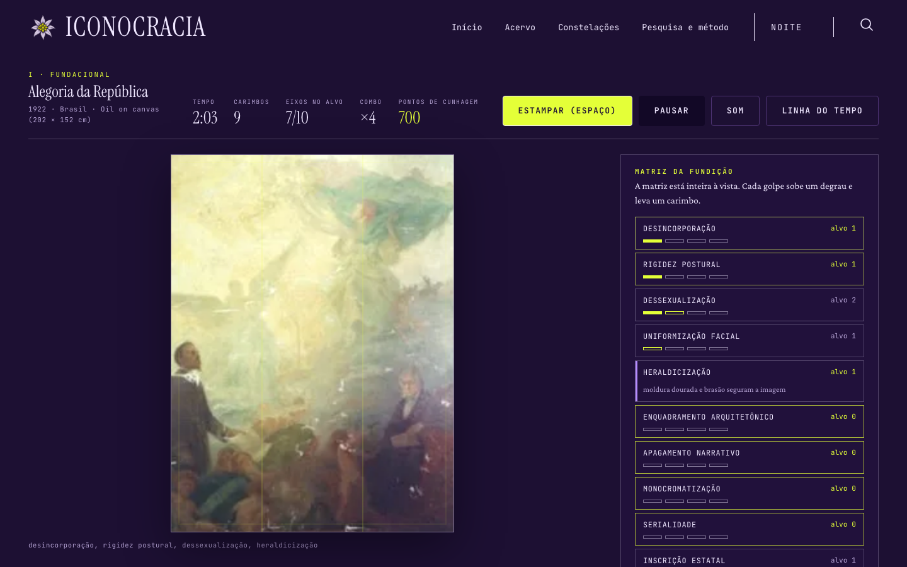
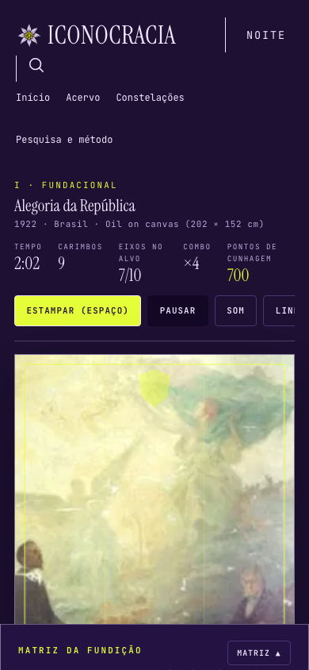

# FUNDIÇÃO — o jogo de arcade do acervo

Documento de design da rota `/jogo` do Mnemosyne Viva. Descreve a fantasia, o
vocabulário mecânico, a regra de pontuação e as garantias metodológicas que o
jogo precisa respeitar para não contradizer a pesquisa que o sustenta.

## O gabinete





## Fantasia

O jogador opera a **prensa do Estado**. Uma alegoria real do acervo está sobre a
platina; a *matriz* do regime exige dez operações determinadas. O jogador aciona
as dez alavancas — os dez indicadores de purificação do próprio corpus — para
dobrar a figura na matriz, contra um relógio e um orçamento de carimbos. A
imagem **transforma-se visivelmente** a cada golpe. Concluir a matriz cunha o
emblema e revela a citação arquivada real do objeto.

O jogo não explica a Purificação Clássica; **faz o jogador executá-la**. Os
verbos são os indicadores, os níveis são objetos reais, os alvos são
codificações reais.

## Vocabulário mecânico

- **estampar** — golpear uma alavanca; eleva o eixo em +1 (0→3) e aplica o
  tratamento visual correspondente.
- **ler a matriz** — consultar os dez eixos e seus valores-alvo.
- **abrir o dossiê** — abrir a ficha do lote: título, data, suporte, país,
  regime, citação, fonte, direitos e proveniência da codificação.
- **recusar** — withholding: o Estado pede o carimbo; a resposta correta é não
  carimbá-lo (etapa IV). Na contra-alegoria a alavanca **é** a recusa: o verbo
  do painel vira "recusar", o botão principal diz `RECUSA` e a tecla `R` recusa
  o eixo selecionado. Uma recusa leva o eixo direto ao perfil real do objeto —
  um ato decisivo, não um degrau a mais.

### Ciclo de um lote (≈ 60–90 s)

1. **Carga** — a ficha do lote nomeia o objeto e o regime; a imagem entra na
   platina.
2. **Matriz** — o painel lista os dez eixos com o valor exigido.
3. **Golpe** — cada alavanca elevation +1, aplica o tratamento e consome um
   carimbo.
4. **Pressão** — o relógio da fundição corre; a platina pulsa quando o tempo
   acaba.
5. **Cunha** — os dez eixos batem com a matriz → o emblema é cunhado: flash,
   impressão do selo, o dossiê abre com a citação real.
6. **Falha** — relógio ou carimbos esgotados → *fundição imperfeita* → repetir o
   lote, sem pontuação.

## Os dez eixos e seus tratamentos

Nomes dos indicadores do projeto, usados como são. O tratamento é CSS sobre o
WebP real:

| Eixo | Tratamento na platina |
|---|---|
| `desincorporacao` | a figura se desprende: escala + contraste, o corpo recua |
| `rigidez_postural` | a imagem se retifica; a pose perde o balanço |
| `dessexualizacao` | o corte fecha para o busto; os tons de pele achatam |
| `uniformizacao_facial` | uma máscara suave em violeta assenta sobre o rosto |
| `heraldizacao` | moldura dourada + brasão seguram a imagem |
| `enquadramento_arquitetonico` | colunas em gradiente repetido ladeiam a figura |
| `apagamento_narrativo` | máscara radial devora o entorno; a figura fica sozinha |
| `monocromatizacao` | escala de cinza + sépia |
| `serialidade` | a figura se duplica numa fileira de três |
| `inscricao_estatal` | uma faixa de legenda carimba o terço inferior |

São **estilizações das operações codificadas, não medições**. O dossiê diz isso
explicitamente.

## Etapas

A tipologia da tese vira a estrutura de níveis.

- **I · FUNDACIONAL** — 10 lotes do Brasil (1888–1890, 1900–1922). Matriz
  inteira à vista, relógio lento, carimbos generosos. Etapa de aprendizado.
- **II · NORMATIVO** — 9 lotes do Brasil. Relógio mais rápido, orçamento menor,
  matriz parcialmente revelada.
- **III · MILITAR — a âncora de iconoclasma** — final: `BR-009` (A Justiça de
  Alfredo Ceschiatti, STF, 1961). **Fora do núcleo 1822–1922 — rotulado como tal
  na interface**, com as duas datas declaradas no dossiê (objeto 1961;
  vandalismo de 8 de janeiro de 2023).
- **IV · CONTRA-ALEGORIA** — 4 lotes (`DE-015`, `US-019`, `FR-031`,
  `SCOUT-571`). **Verbo invertido:** o Estado pede o carimbo; a jogada correta é
  retirar a mão e acionar **RECUSA**.

Dentro da etapa, os lotes seguem o ano. A seleção de nível é uma **Linha do
tempo**, não um menu clássico.

### A matriz parcial (etapas II a IV)

A etapa I entrega a matriz inteira à vista. As demais entregam **parte dela**:

| Etapa | Eixos lidos de saída | Custo de ler o resto |
|---|---|---|
| I · Fundacional | 10 de 10 | — |
| II · Normativo | 6 de 10 | 2 s por eixo |
| III · Militar | 5 de 10 | 2 s por eixo |
| IV · Contra-alegoria | 4 de 10 | 2 s por eixo |

Uma alavanca cujo valor ainda não foi lido mostra `não lido`; golpeá-la **lê**

 a matriz em vez de estampar — custa dois segundos do relógio e não gasta
carimbo. Ler é, portanto, uma decisão com preço: o tempo que se paga para
saber é tempo que não se tem para cunhar. Golpear no escuro continua possível
e continua custando um carimbo e o combo.

### O golpe errado

Golpear um eixo que já está no alvo **não o move**: o golpe é recusado pela
matriz, o carimbo se perde e o combo zera. Assim o erro custa tempo e
orçamento, mas nunca torna o lote impossível — uma fundição perdida é sempre
recuperável.

## Regra de pontuação

- **Por eixo, nunca somado:** cada eixo acertado = 100 × combo. O combo cresce
  com golpes corretos consecutivos e zera no golpe errado (carimbar um eixo
  acima do alvo da matriz).
- **Bônus de tempo** e **bônus de precisão** — a *fundição precisa* é a fundição
  em que **nenhum carimbo foi desperdiçado**: todo golpe dado levou um eixo ao
  alvo. (O orçamento de carimbos é o mínimo exigido mais uma folga por etapa;
  a folga é o que torna recuperável um único erro, e por isso "usar todos os
  carimbos" não pode ser o critério de precisão — seria preciso desperdiçá-los
  para ganhá-lo.)
- A pontuação chama-se `pontos de cunhagem` e vive num campo de jogo.
- **Nenhum campo mostra, em momento algum, uma figura normalizada, média ou
  "endurecimento" de um objeto.** A matriz por eixo *é* o perfil publicado do
  lote, capturado no dossiê como ato interpretativo.
- O orçamento de carimbos é autorado por lote como um número simples de
  carimbos; a soma dos dez eixos é usada **apenas em tempo de build**, para
  definir esse orçamento, e nunca é exibida, nomeada ou guardada como agregado.

## Garantias metodológicas

Três regras, verificadas por teste e não por boa vontade:

1. **Nada de código pendente entra como zero.** As linhas com
   `coded_by: vault-import` ou `migration` e vetor todo-zero são *codificação
   pendente*, não observação de ausência. A regra do projeto: item não
   codificado fica `null`, nunca `0`.
2. **Nada de base textual vira transformação visual.** `BR-007` e `BR-008`
   foram codificados a partir de palavras; uma metamorfose visual os
   desrepresentaria.
3. **Nada de soma.** Os dez eixos nunca viram um número único — nem no dado,
   nem na interface, nem no texto do código.

Acrescente-se a isso: **conflitos entre os dois ledgers canônicos são
excluídos** (`BE-004` diverge entre `purification.jsonl` e
`records.jsonl`), e o relatório de build imprime quantos IDs foram excluídos
e por quê, para que uma releitura futura não derrube um lote em silêncio.

## Arquitetura

- **Sem engine, sem bundler.** Módulos ES nativos + DOM/CSS; um canvas só para
  efeitos. A publicação do site é estática (Cloudflare Worker + binding
  `ASSETS`) e a regra do repositório para páginas internas é *sem build, sem
  framework*.
- `press.js` guarda o estado do lote e a máquina de fases; **nunca toca o DOM**.
- `render.js` pinta a partir do estado; **nunca muta o estado**.
- `fx.js` é decoração; pode ser desligado por inteiro (movimento reduzido)
  sem afetar a simulação.
- `levels.js` busca e valida `site/data/jogo.json` antes do primeiro quadro.
- O esquema do manifesto vive em `schemas/jogo.schema.json`, junto dos outros
  esquemas do repositório (`acervo`, `corpus-data-enriched`, `publication`) — a
  regra do repositório é um diretório `schemas/` na raiz, não `site/schemas/`.
- Persistência só em `localStorage`, sob uma chave com namespace. **Sem
  escrita no servidor.**

### Entradas

O jogo não mora na navegação do topo — que fica intacta. Ele entra pelo herói
da página inicial e por um convite em `/sobre`. No herói, a ação do jogo é a
**segunda** posição, e não a terceira: a regra de produção
`.home-actions > a:last-child` sublinha o último filho, e um botão escuro com
sublinhado quebraria o contraste no modo dia. Mover o link dos dossiês para o
meio apenas transferiria o sublinhado para outro elemento. A ordem do herói é,
portanto, uma decisão de CSS, não um detalhe de redação.

### Entrada

```
1…0 / Q…P  selecionar eixo        Espaço / Enter  carimbar o eixo
R         recusar (etapa IV)       Esc            pausa / dossiê
?         controles               setas         mover a seleção
```

## Pipeline de dados

`scripts/build_game_data.py` lê o corpus **fixado** (mesma disciplina de
`--version <commit>` de `corpus_sync.py`) e emite `site/data/jogo.json`.
Os filtros de elegibilidade são, na ordem:

1. ID presente em `site/data/acervo.json`, `tem_imagem` verdadeiro e
   `site/assets/acervo/<id>.webp` existente em disco.
2. Linha presente em `data/processed/purification.jsonl` (a chave de junção).
3. `coded_by` fora de `{vault-import, migration}`.
4. Vetor não todo-zero.
5. Notas livres de `TEXTUAL`, `not visual`, `#sem-iiif`.
6. Notas livres de `PENDING_REVIEW` / `tentativ`.
7. Vetores de `purification.jsonl` e `records.jsonl` coincidentes.
8. Janela de ano por etapa: Brasil 1822–1922 nas etapas I–II; lista de
   autorização explícita nas etapas III–IV.

O relatório de build imprime os IDs excluídos por regra.

## Design system

O jogo herda o sistema existente sem alterá-lo. Usa apenas a camada `--ex-*`
de produção (`--ex-action #e4ff38` como única cor de ação, `--ex-selection
#b48bff` para foco e seleção). `site/assets/style.css` **não é tocado**.

Strings de jogo em português; identificadores de código no estilo de
`site/assets/app.js`.

- `prefers-reduced-motion`: camada de efeitos desligada, transições reduzidas
  a opacidade, o relógio continua.
- Paridade de teclado e leitor de tela: cada alavanca é um controle focável com
  nome acessível (*rigidez postural — alvo 2, atual 1*); a platina tem `alt`
  descritivo que nomeia a figura e os tratamentos aplicados.
- Móvel (390×844): o painel da matriz vira gaveta inferior; a platina mantém a
  metade superior; o HUD permanente é uma faixa no topo.

## Áudio

Nenhum arquivo de áudio é publicado. A WebAudio sintetiza a prensa: golpe de
ruído filtrado com baque afinado, catraca do relógio, acorde brilhante na
cunha. Mudo por padrão, com interruptor visível.

## Riscos em aberto

1. **Publicar vetores por eixo num site público.** Os dez eixos não foram
   aposentados — o índice composto foi (`DEC-2026-07-28`,
   `DEC-2026-09-24`). O padrão implementado publica os valores por eixo
   **só** para os lotes da campanha, **só** em `jogo.json`, cada um com
   codificador, data, notas e justificativa de regime, e com a legenda do
   próprio corpus no dossiê. Se Ana preferir o contrário, a alternativa é
   manter os eixos fora do dado público e alimentar a matriz por um
   `jogo.json` curado e opaco — o jogo permanece, o dado não.
2. **Tom da metáfora da prensa.** A máquina encena a apagamento da figura
   feminina como mecânica satisfatória. Contramedidas: a etapa IV inverte o
   verbo, o dossiê nomeia as mulheres históricas e as exclusões, e o resumo
   da campanha lista objetos em vez de pontuar o corpus.
3. **Direitos.** 4 dos 19 lotes do núcleo trazem `direitos` explícito; o resto
   está vazio. As imagens já são publicadas em iconocracia.com, então o jogo
   não amplia a exposição — o dossiê mostra `direitos` quando existe e o
   link de fonte sempre.
