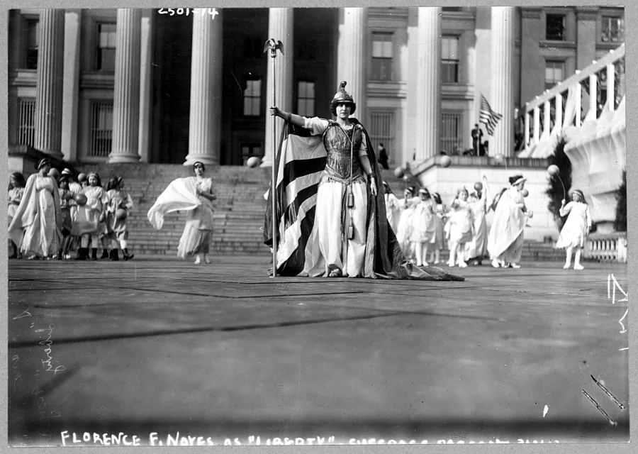
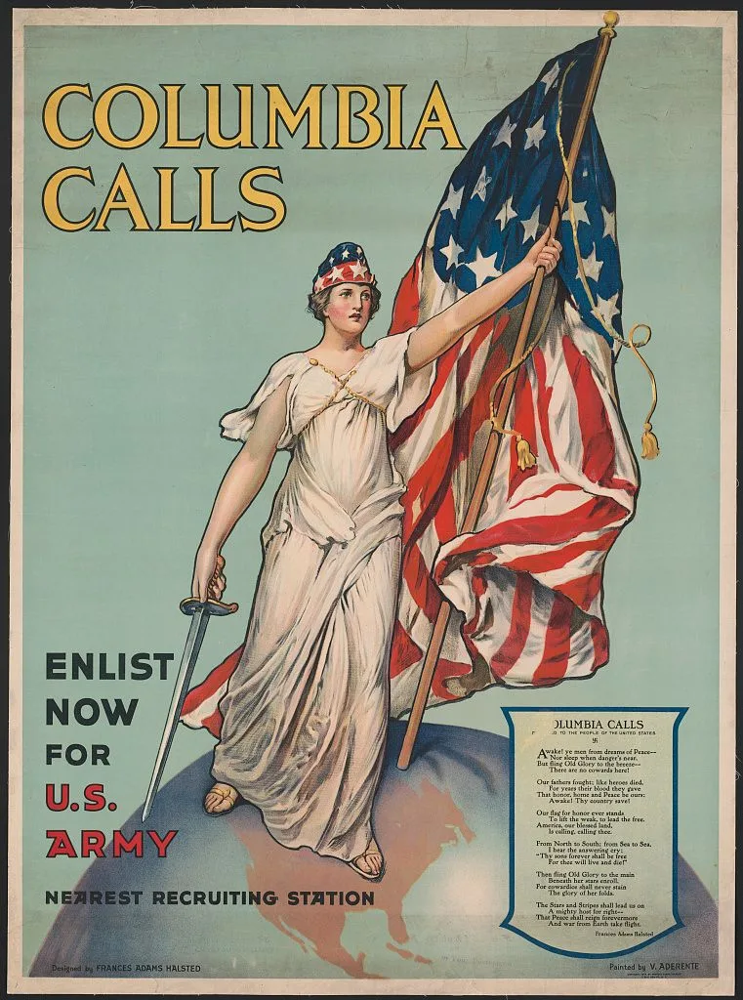

# Columbia — dois chamados da nação

Situação: publicação autorizada por Ana em 13 de outubro de 2026, nesta conversa.
Revisão assistida com Mnemosyne Research Atelier em 13 de outubro de 2026.

**Pergunta da montagem:** como a mesma personificação nacional participa de uma
reivindicação de direitos políticos e de uma convocação ao serviço militar?

| Reivindicar participação política | Convocar ao serviço militar |
| --- | --- |
|  |  |
| **Hedwig Reicher como Columbia**, Washington, 3 de março de 1913. Fotografia; autoria fotográfica não indicada no registro consultado. [ICONOCRACIA · US-008](https://iconocracia.com/acervo.html?item=US-008). | **Columbia calls — Enlist now for U.S. Army**. Concepção de Frances Adams Halsted; pintura de Vincent Aderente. Litografia colorida; o catálogo da Library of Congress registra `c1916`. [Registro no acervo](https://iconocracia.com/acervo.html?item=473ac4d7-a507-51c6-8215-983c2442fc23). |

## Elo visual

Nas reproduções examinadas, Columbia ocupa posição dominante, com vestes longas,
emblemas nacionais e um braço estendido. Reicher porta capacete e couraça diante
de outras participantes; no cartaz, a figura ergue a bandeira, segura uma espada
e se apoia sobre a América do Norte no globo. A montagem aproxima esses gestos e
atributos, preservando a diferença entre a encenação fotografada e a imagem impressa.

## Elo histórico

A fotografia registra Columbia numa encenação vinculada à procissão sufragista
de 3 de março de 1913, diante do edifício do Tesouro, em Washington. O cartaz
convoca ao alistamento no Exército; segundo a nota curatorial da Library of
Congress, Halsted doou o poema e o desenho ao Departamento de Guerra após a
entrada dos Estados Unidos na guerra, em 6 de abril de 1917. As fontes documentam
a mesma personificação nacional em mobilizações com finalidades distintas.
[Fotografia — registro institucional](https://www.loc.gov/item/97510759/);
[cartaz — registro e nota curatorial](https://www.loc.gov/item/95506508/).

## Leitura proposta

A aproximação permite perguntar quem pode falar em nome da nação e o que essa
voz exige. Na encenação sufragista, Columbia participa da reivindicação de
direitos políticos; no cartaz, personifica o chamado ao serviço militar.
A couraça de Reicher mostra que atributos marciais também podiam servir à
reivindicação sufragista. A comparação evidencia usos distintos de um repertório
compartilhado; não estabelece uma sequência evolutiva entre eles.

## Proveniência, confiança e limites

- **Base examinada:** reproduções digitais locais dos dois itens e metadados dos
  registros institucionais recuperados pela busca indexada da Library of Congress.
  As páginas integrais retornaram bloqueio de acesso durante a revisão de 13 de outubro.
  Não houve exame material dos originais.
- **Fotografia:** Library of Congress, George Grantham Bain Collection, registro
  `97510759`, cota `LOT 11052-2`, reprodução digital `ppmsc.00032`. A legenda visível
  menciona Florence F. Noyes como “Liberty”; o catálogo identifica a figura central
  como Reicher e observa que a legenda pode referir-se a uma participante velada
  ao fundo. Não se trata de identificar a protagonista pela inscrição isolada.
- **Cartaz:** Library of Congress, registro `95506508`, cota
  `POS - US .H348, no. 1 (C size)`, reprodução digital `ppmsca.50012`.
  O acervo local indica **1917**; o catálogo institucional registra literalmente
  **`c1916`** e informa copyright de Frances Adams Halsted. A doação em **1917**
  é uma etapa documental distinta e não determina, sozinha, a data de impressão
  do exemplar. A tiragem e o impressor não são afirmados nesta montagem.
- **Confiança:** alta quanto à identidade alegórica compartilhada e aos contextos
  documentados. A leitura da autoridade corporal é uma interpretação da montagem;
  influência direta entre as duas imagens não foi demonstrada.
- **Próxima verificação:** consultar programa e documentação de produção das duas
  peças para investigar eventuais mediações entre seus repertórios visuais.

**Tags controladas:** gênero e cidadania; militarização — no cartaz.
**Termos propostos:** Columbia; alegoria encenada; recrutamento militar.

## Fontes

1. Library of Congress. [Hedwig Reicher como Columbia, 3 de março de 1913](https://www.loc.gov/item/97510759/).
2. Library of Congress. [Columbia calls — Enlist now for U.S. Army](https://www.loc.gov/item/95506508/).
3. ICONOCRACIA. Registros `US-008` e `473ac4d7-a507-51c6-8215-983c2442fc23` em
   [acervo.json](../../site/data/acervo.json). Vocabulário da skill Mnemosyne Research Atelier,
   edição instalada e consultada nesta revisão.
