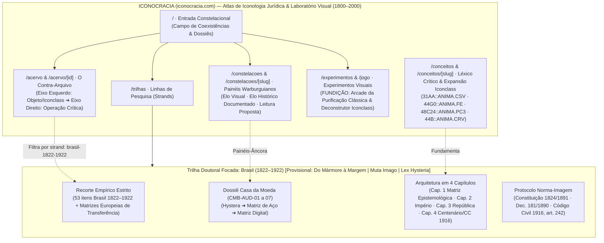

# ICONOCRACIA — Site Map & Knowledge Base Architecture

**Status:** Canonical Architecture Blueprint (2026-11-02)  
**Macro-Umbrella (The Atlas & Visual Experiment):** **ICONOCRACIA** (`iconocracia.com`)  
**Focused Doctoral Strand (Brazil, 1822–1922):** Provisional working titles (pending final authorial selection by Ana Vitória Vanzin Mendes):
1. ***Do Mármore à Margem*** *(Do Mármore à Margem: Alegorias femininas, matriz fiduciária e subordinação civil no Brasil, 1822–1922)*
2. ***Muta Imago*** *(Muta Imago: O Contrato Sexual Visual e a Feminilidade de Estado no Brasil, 1822–1922)*
3. ***Lex Hysteria*** *(Lex Hysteria: Corpo errante, matriz de aço e purificação clássica na cultura jurídica brasileira, 1822–1922)*

---

## 1. Architectural Separation: The Open Atlas vs. The Doctoral Thesis

### Why This Separation Matters
- **ICONOCRACIA (`iconocracia.com`)** is **not** a mere digital appendix to the dissertation. It is an open, transnational **Atlas of Legal Iconology and Visual Experiment** (`1800–2000`, 17+ countries, 337+ catalogued objects) that exposes the blind spots of traditional art-historical classification (`Iconclass`) and stages visual experiments (`Constelações`, `FUNDIÇÃO`, the `Counter-Archive` dual-axis deconstructor).
- **The Doctoral Thesis (`Brazil, 1822–1922`)** — provisionally titled ***Do Mármore à Margem***, ***Muta Imago***, or ***Lex Hysteria*** — is a **focused, bounded research strand** inside the Atlas. It mobilizes a strict subset of the database (the 53 Brazilian items between Independence and the Centenary, paired with their European models, the Casa da Moeda dies, and positive civil/constitutional law) to prove a specific historical and legal verdict.

---

## 2. Complete Site Map (`iconocracia.com`)

| Route | Surface Name | Role in the Ecosystem | Primary Entities Rendered |
| :--- | :--- | :--- | :--- |
| **`/`** | **O Atlas (Início)** | Spatial constellation field (16 anchor plates), the 3 Coexistence Dossiers (*Columbia*, *Marianne*, *Brasil*), live corpus counters, and entry gateways to the Counter-Archive, Visual Experiments, and the Doctoral Strand. | `Constellation` previews, `Object` cards, `Strand` gateway |
| **`/acervo`** | **Acervo & Filtro Contra-Arquivo** | Searchable, filterable index of all published artifacts (`1800–2000`) by country, support, iconocratic regime (*Fundacional*, *Normativo*, *Militar*, plus *Contra-alegoria* as critical test), motif, and research strand (`Todos` vs. `Recorte da Tese: Brasil 1822–1922`). | `Object[]`, `Image[]`, `Strand` filter |
| **`/acervo/[id]`** | **Ficha Contra-Arquivo (Dual-Axis)** | Citable per-object page (`/acervo/BR-009`, `/acervo/US-008`) with the **Progressive X-Ray Toggle**: • **Left Axis (The Facade):** Verified `Object` metadata, `Image` rights/SHA-256, ABNT NBR 6023:2025 `Source`, Panofsky L1 `observed_motifs`, and passive `Iconclass` codes (`31AA`, `44G0`, `48C24`, `44B`). • **Right Axis (The Operation):** Approved `Claim` records, `Concept` links, the *hystera → matrix / matriz* dimension, and the **Warburgian Temporal Coexistence Slider**. | `Object`, `Image[]`, `Source[]`, approved `Claim[]`, `Concept[]` |
| **`/constelacoes`** | **Constelações (Painéis)** | Index of authored Warburgian montages organized around a research question rather than linear chronology. | `Constellation[]` |
| **`/constelacoes/[slug]`** | **Montagem Constelacional** | Full comparative panel (e.g., `/constelacoes/columbia-dois-chamados`, `/constelacoes/hystera-matriz-casa-da-moeda`) structured strictly into: (1) *Pergunta da montagem*, (2) *Elo visual*, (3) *Elo histórico documentado*, (4) *Leitura proposta* (`Claim`s), and (5) *Proveniência, confiança e limites*. | `Constellation`, `Object[]`, `Source[]`, `Claim[]` |
| **`/conceitos`** | **Léxico & Expansão Iconclass** | Dedicated theoretical index defining the project's proprietary vocabulary and its formal counter-notation expansion of Iconclass. | `Concept[]` |
| **`/conceitos/[slug]`** | **Verbete Conceitual** | Citable definition page (`/conceitos/contrato-sexual-visual`, `/conceitos/feminilidade-de-estado`, `/conceitos/purificacao-classica`, `/conceitos/contrato-racial-visual`, `/conceitos/marmore-a-margem`, `/conceitos/lex-hysteria-matriz`) with genealogy, interlocutors (Pateman, Legendre, Mondzain, Warburg, Goodrich), and every `Object` and `Claim` mobilizing the concept. | `Concept`, `Source[]`, `Claim[]`, `Object[]` |
| **`/experimentos`** | **Laboratório Visual** | Hub for interactive visual experiments that declare their pinned data inputs and methodological limits. Includes `/jogo` (**FUNDIÇÃO — Arcade da Purificação Clássica**) and the interactive **Deconstrutor Iconclass (31AA ➔ ANIMA)**. | `Experiment[]` |
| **`/trilhas/brasil-1822-1922`** *(alias `/tese`)* | **A Tese (Brasil, 1822–1922)** | Dedicated portal for the doctoral research strand (*Do Mármore à Margem* / *Muta Imago* / *Lex Hysteria* [provisional]): presents the 1822–1922 inclusion criteria, the 4 Hybrid Chapters, the Casa da Moeda numismatic audit (`CMB-AUD-01..07`), the Norm-Image Coupling Protocol (Constituição 1824/1891, Dec. 181/1890, CC/1916 art. 242), and the 53 Brazilian core items. | `Strand`, `Essay[]`, `Object[]`, `Claim[]`, `Constellation[]` |
| **`/sobre`** | **Método & Governança Editorial** | Explains the epistemological architecture of the Atlas, the separation between `Object`/`Source` and `Claim`/`Concept`, the SHA-256 publication gates, and open-data licensing (`CC-BY-4.0`). | Static editorial documentation |

---

## 3. Knowledge Base Architecture: The Threefold *Matrix* & Taxonomic Expansion

### 3.1 The *Hystera → Matrix → Matriz* Triad (Core Thread of the Doctoral Strand)

| Dimension | Classical / Archival Term | Mechanism in *Do Mármore à Margem / Muta Imago / Lex Hysteria* | Data Model Representation |
| :--- | :--- | :--- | :--- |
| **1. Anatomical / Legal Diagnosis** | **Hystera (ὑστέρα)** → *Matrix* (womb) | In the Hippocratic *Gynaikeia*, female pathology stems from displacement: the wandering womb must be weighed down and anchored. Nineteenth-century positive law (Ordenações Filipinas, Dec. 181/1890, Código Civil de 1916, art. 6º II & art. 242) diagnoses living women as unstable subjects requiring civil tutelage at the margins. | `Claim.matrix_triad_dimension = "hystera_tutelage"` coupled to `Source` (`source_type = "legislation"`) |
| **2. Material / Numismatic Cure** | **Matriz (Cunho de Aço)** & Monumental Stone/Bronze | State art and the Seção de Gravura of the Casa da Moeda (Carneiro, Girardet, Villares) "cure" that perceived female unruliness by engraving the female form into an immobile steel **matriz** to strike currency, or casting her in petrified marble and granite (*Purificação Clássica*). Yet in a Warburgian sense (*Bilderwanderung*), these allegories refuse to stay still—migrating across oceans, regimes, coins, and courthouses. | `Object.support = "moeda" | "matriz-cunho" | "escultura"` + `Claim.matrix_triad_dimension = "numismatic_die_matriz"` |
| **3. Epistemic / Digital Grid** | **Matriz de Dados (Counter-Archive Schema)** | Standard art-historical databases (`Iconclass`) index the female body (`31AA`) and its medium (`48C24`) as neutral descriptive facts, reproducing the state's facade. The Counter-Archive database **matriz** splits the record into two axes (`Object` vs. `Claim`), making the political operation visible and citable. | `Object.standard_cataloging` (Left Axis) paired with `Claim.deconstructs_iconclass` (Right Axis) |

### 3.2 Expanding Iconclass: The Counter-Archive Crosswalk

Instead of discarding `Iconclass`, the Knowledge Base uses standard `Iconclass` notations on the **Left Axis** as the administrative baseline and pairs them with formal **Counter-Archive Notations** on the **Right Axis**:

| Standard Iconclass (Left Axis — The Facade) | Counter-Archive Notation (Right Axis — The Operation) | Concept Mobilized | Deconstructive Rule |
| :--- | :--- | :--- | :--- |
| **`31AA`** — *Female human figure* | **`31AA::CSV`** | **Contrato Sexual Visual** | Exposes how the hyper-visibility of the `31AA` female anatomy in state iconography masks the civil and political exclusion of living women (*Reconhecimento sem Reciprocidade*). |
| **`44G0`** — *Allegory of Jurisprudence / Justice* | **`44G0::FE`** | **Feminilidade de Estado** | Exposes how the state administers the female form as a public infrastructure of fiduciary and judicial affect, emptying historical subjectivity to legitimize a masculine legal apparatus (`Muta Imago`). |
| **`48C24`** / **`48C51`** — *Sculpture / Engraved Coin & Medal* | **`48C24::PC`** / **`48C24::MM`** | **Purificação Clássica** & **Mármore à Margem** | Replaces neutral medium cataloging with qualitative hardening indicators (postural rigidity, facial uniformity, narrative erasure) and traces the *hystera → matriz* anchoring in stone, bronze, and steel dies. |
| **`44B`** — *Symbols of the State / Ruler* | **`44B::CRV`** | **Contrato Racial Visual** | Deconstructs the supposed universality of `44B` state personifications by documenting the transatlantic transfer of neoclassical whiteness that overwrites Afro-Brazilian and Indigenous presence post-1888/1889. |
| **`44B191`** — *Phrygian Cap / Liberty Attributes* | **`44B191::COEX`** | **Coexistência & Recusa** | Tracks when insurgent attributes (barrete frígio, active sword, bare breast) are convoked, domesticated into laurel diadems, or relegated to the reverse of coins across regimes. |
